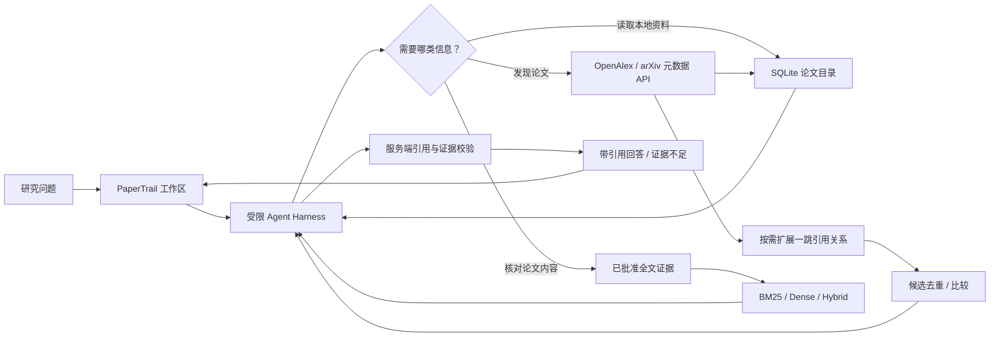

# PaperTrail · 论文检索与研究助理 Agent

**论文检索、全文证据查找与文献比较。**

[](https://github.com/ZXN1225/papertrail/actions/workflows/ci.yml)


PaperTrail 是一个全栈论文检索与研究助理项目，整合 OpenAlex、arXiv 和经许可导入的本地全文，支持论文比较与证据检索。

## 项目能做什么

- **发现与管理论文**：从 OpenAlex、arXiv 搜索元数据，或使用已导入的本地目录；保存查询快照、来源、版本和内容哈希，支持重复导入与历史快照查看。
- **扩展文献集合**：从种子论文沿 OpenAlex 参考文献或被引关系拓展一跳，并比较候选。
- **许可全文问答**：逐篇登记并确认 CC0 或 CC BY 许可后，才可将本地 PDF 或 UTF-8 文本导入；全文做结构化解析后按可追踪位置分块，支持 BM25、Dense 和 Hybrid 检索。
- **可核验回答**：引用关联到本轮检索结果；全文证据保留片段、来源、许可和位置。
- **运行时 Agent Skills**：内置三种任务工作流；激活后，模型只能使用该 Skill 的固定工具子集。
- **连续研究上下文**：后续提问可引用最近的检索条件、书目结果和对话内容；论文正文仍以工具返回的全文证据为准。
- **只读 MCP 集成**：以 stdio MCP Server 暴露固定的只读论文工具，外部 Host 无法借此写库或访问任意 URL。
- **检索实验**：在相同语料和查询上比较 BM25、Dense cosine 与 RRF Hybrid，输出指标、配置、数据哈希和成本估算。
- **研究工作区**：浏览论文、查看详情、比较元数据，并检索引用和全文证据。

## 工作流



Agent 通过服务端固定工具读取论文资料，不开放任意 URL、shell、SQL 或写入操作。外部 MCP Host 走同一个只读工具注册表。

## Agent 与 RAG 设计

### 固定工具集

| 工具类型 | 能力                                                                       | 边界                                                                                                                                                                              |
| -------- | -------------------------------------------------------------------------- | --------------------------------------------------------------------------------------------------------------------------------------------------------------------------------- |
| 本地目录 | 搜索论文、读取详情、查找词法相似论文、比较 2–5 篇论文                      | 只读已导入的元数据；“相似”不是引用关系                                                                                                                                            |
| OpenAlex | 搜索/读取 Works、Authors、作者 Works；按需扩展种子论文的参考文献或被引作品 | 固定官方 API 主机；年份/OA 条件为结构化白名单；最多一跳、每方向最多 10 条；关系只作发现线索。调用依据：[OpenAlex 引用 API recipes](https://help.openalex.org/how-to/api-recipes/) |
| arXiv    | 搜索和读取论文元数据；支持提交年份范围                                     | 固定官方 API；限速；年份按提交日期筛选；不会通过该工具下载 PDF                                                                                                                    |
| 许可全文 | 检索批准全文的片段并返回定位与署名信息                                     | 仅使用当前批准版本；BM25 默认，Dense/Hybrid 需显式启用 Embeddings                                                                                                                 |

### Agent Harness 的运行约束

- 工具参数经 Pydantic schema 验证，未知工具和多余参数会被拒绝；Trace 只记录已注册工具名，未知名称统一记为 `unknown_tool`。
- 每次运行限制决策步数、工具调用次数、总时限和观察内容大小。
- **每次模型请求前先按输入上界预留额度**：以指令、完整输入、工具 schema 与响应格式的 UTF-8 字节上界（加固定余量）从共享预算中先行扣留，再把输出上限收紧为 `min(配置上限, 剩余额度 − 输入预留)`；预留后没有输出空间就在调用前以 `token_budget_exceeded` 结束。provider 回报的实际输入超过上界时立即停止后续步骤。
- embedding 查询同样在调用前按 query 字节数预检；额度不足时不发起请求，实际用量超过估算上界时计入并停止后续步骤。
- Harness 校验模型给出的引用是否来自本轮工具观察，并验证证据片段和论文 ID 的对应关系。
- 元数据只能支持元数据层面的说法；论文结论必须有全文证据。证据不足时明确拒答，不从模型记忆补写论文事实。
- 运行账本只保存 run ID、问题哈希、状态、时间、用量计数与脱敏 trace，**不保存问题正文、答案或论文摘录**；因此重启后不会自动重放模型调用。
- 回答论文方法或发现时使用获准全文证据；只有书目数据时，回答限于书目信息。

### Runtime Skills

| Skill            | 适用任务                      | 允许的工具范围                     |
| ---------------- | ----------------------------- | ---------------------------------- |
| `paper-qa`       | 单篇论文的证据问答            | 获准全文证据检索与精确元数据读取   |
| `compare-papers` | 比较两篇及以上论文的方法/发现 | 本地目录比较与获准全文证据检索     |
| `research-brief` | 汇总一个主题的研究脉络        | 元数据发现、引用扩展与全文证据检索 |

Skill 定义保存在 `backend/app/agent/skill_specs/*.SKILL.md`，注册表与指令正文都有 SHA-256 pin：正文漂移会被拒绝。Harness 取“Skill 推荐工具”与“本轮已注册工具”的交集，**Skill 不能扩大工具权限**；每次运行最多激活一个 Skill。

### 检索策略选型及原因

| 研究需求               | 选用策略                                     | 选型原因                                                                    | 实测依据与边界                                                                                      |
| ---------------------- | -------------------------------------------- | --------------------------------------------------------------------------- | --------------------------------------------------------------------------------------------------- |
| 发现论文、浏览书目     | OpenAlex / arXiv 元数据检索；本地目录用 BM25 | 公开来源提供结构化书目字段；本地 BM25 无 Embedding 费用，结果容易复现和解释 | P05 小样本人工复核；OpenAlex 按出版年筛选，arXiv 按提交日期筛选                                     |
| 根据获准全文查找证据   | 全文 BM25 默认；Dense 或 RRF Hybrid 显式启用 | 全文需逐篇通过许可登记；BM25 保持本地可用，语义检索作为可选对照             | P14 在冻结元数据集上做过排序诊断，但并非全文 RAG 质量评测；当前真实许可全文规模也不足以支持统计结论 |
| 从种子论文拓展研究脉络 | OpenAlex 一跳参考文献 / 被引关系             | 引用邻居能补充关键词检索未命中的候选，且保留来源和关系便于复核              | 仅作发现线索；不是论文结论的证据，也不假设新候选比原搜索结果更相关                                  |
| 合并多个公开来源结果   | OpenAlex + arXiv，按完全匹配 DOI 去重        | 兼顾综合书目与预印本发现；严格 DOI 匹配避免仅凭标题误合并                   | 按完全匹配 DOI 去重，不依据标题猜测相同作品                                                         |

BM25 为默认全文检索。Dense 可选使用 OpenAI embeddings 与 cosine 相似度；Hybrid 使用 BM25 与 Dense 排名进行 RRF（`k=60`）。Embedding provider 默认关闭；启用后，问题和获准全文片段会发送到配置的 API。

下面是 P14 的**历史元数据排序实验**：冻结的 100 篇论文、30 个查询，使用未经人工核验的助手相关性标签，指标只供探索诊断。BM25 的 Hit@1 `0.5333`、MRR@10 `0.6444`、NDCG@10 `0.5222`。

| Embedding 配置 | Dense：Hit@1 / MRR@10 / NDCG@10 | Hybrid：Hit@1 / MRR@10 / NDCG@10 |                  估算 Embedding 费用 |
| -------------- | ------------------------------: | -------------------------------: | -----------------------------------: |
| P14 Small      |        0.8333 / 0.8562 / 0.6464 |         0.7000 / 0.8208 / 0.6321 | $0.0004792/次；两次合计约 $0.0009584 |

该组标签下 Dense 的 Hit@1/MRR 较高而 Hybrid 的 NDCG 略低；标签未经人工核验，结果仅作探索对照。

## 技术栈

| 层     | 技术                                                                      |
| ------ | ------------------------------------------------------------------------- |
| Web    | Next.js 16、React 19、TypeScript                                          |
| API    | FastAPI、Pydantic、Uvicorn                                                |
| Agent  | OpenAI Responses API function calling、受限 Agent Harness、服务端引用校验 |
| MCP    | 只读 stdio MCP Server、固定工具注册表                                     |
| 数据   | SQLite、SQL 迁移、不可变元数据版本、来源快照与 SHA-256                    |
| 数据源 | OpenAlex Works / Authors API、arXiv API、逐篇许可的本机 PDF 全文          |
| 检索   | 自实现 Okapi BM25、可选 OpenAI Embeddings cosine、RRF@60                  |
| 解析   | pdfplumber 结构化解析（元素/章节/表格/图注 + 页级 bbox 与解析告警）       |
| 测试   | pytest、Ruff、Prettier、TypeScript、Playwright、GitHub Actions            |

## 检索策略与评测证据

评测覆盖公开元数据检索、本地 BM25、可选 Dense/Hybrid 全文检索和许可全文的证据命中。

| 评测项目                                               | 结果用途                                                             | 结论边界                                                             |
| ------------------------------------------------------ | -------------------------------------------------------------------- | -------------------------------------------------------------------- |
| P05 人工复核集：8 个查询、10 篇论文、80 个判断         | BM25 指标和相关性评测流程可在冻结数据上复现                          | 样本太小，不能代表一般检索表现                                       |
| P13/P14：30 个查询、100 篇元数据、助手生成的候选标签   | 可重复对照 BM25、Dense、Hybrid 的实现、配置和运行成本                | 标签未人工核验，不能证明哪种方法质量更好                             |
| R02：9 篇许可全文、217 页、3,294 个 chunk 的解析与索引 | 冻结每篇的 PDF SHA、许可、parser 版本与逐 chunk 内容哈希，升级可审计 | lineage 只证明来源与索引可追溯，**不证明解析内容正确**               |
| R01/R03：9 篇许可全文上的 53 题 AI 标注检索评测        | 在同一活动索引上度量“证据是否进了 top-k”，并按题型定位短板           | 标签由 AI Agent 标注、非人工金标；题目写自被评测索引本身，分数偏乐观 |

### 许可全文上的证据命中（活动索引 v27，全库 3,294 chunks/查询）

| 指标             | 结果                  |
| ---------------- | --------------------- |
| 证据命中 @1      | 26 / 44 = 59.1%       |
| 证据命中 @8      | 39 / 44 = 88.6%       |
| `figure_caption` | 5 / 5                 |
| `single_fact`    | 22 / 24               |
| `multi_hop`      | 11 / 12               |
| `table_lookup`   | **1 / 3**（明确短板） |

不可答题的可分性（诊断）：BM25 top-1 分数上可答题均值 **32.5**、不可答题均值 **18.3**，本样本中不可答题的最高分低于可答题的均值。该观察只有 9 道负例，不足以声称存在普遍可用的阈值。

`table_lookup` 偏低与 [R02 v27 解析升级记录](docs/research/R02-v27-parse-upgrade.md) 中记录的表头切词/单元格归属缺陷方向一致：列标签不可复原时，按表头词语提问自然检索不到。该题型只有 3 道，只能作为线索。

其余评测记录见：[P05 人工复核](docs/research/P05-acceptance.md) · [P14 检索对照](docs/research/P14-acceptance.md) · [R01/R03 AI 标注评测](docs/research/R01-R03-ai-labeled-evaluation.md) · [阶段记录](docs/research/)。

## 本地运行

### 环境要求

- Python 3.12 与 [uv](https://docs.astral.sh/uv/)
- Node.js 24 与 pnpm 11
- SQLite 随应用运行，无需单独安装数据库服务

### 配置服务端环境

在仓库根目录复制配置模板；若 `.env` 已存在，不要覆盖：

```powershell
if (-not (Test-Path .env)) { Copy-Item .env.example .env }
```

编辑 `.env`。`OPENALEX_API_KEY` 可选；`LLM_PROVIDER` 和 `EMBEDDING_PROVIDER` 默认均为 `disabled`。只有显式配置服务端模型凭据后，Agent 或 Dense/Hybrid Embeddings 才会调用 OpenAI。不要把密钥写入 Web 环境变量或提交到 Git。

### 启动 API 与 Web

终端一启动后端：

```powershell
cd backend
uv sync --locked --all-groups
uv run --locked uvicorn app.main:app --host 127.0.0.1 --port 8001 --reload
```

终端二启动 Web：

```powershell
cd web
pnpm install --frozen-lockfile
pnpm dev
```

打开 <http://127.0.0.1:3000>。API 文档位于 <http://127.0.0.1:8001/docs>；存活与就绪检查分别是 `/api/health/live` 和 `/api/health/ready`。首次 Web 安装后如果没有 Playwright 浏览器，执行 `pnpm exec playwright install chromium`。

### 导入论文数据

导入少量 OpenAlex 元数据到本地 SQLite：

```powershell
cd backend
uv run --locked python -m app.cli.import_openalex --query "retrieval augmented generation" --per-page 10
```

导入一页 arXiv 元数据：

```powershell
uv run --locked python -m app.cli.import_arxiv --query 'all:"retrieval augmented generation"' --max-results 10
```

元数据搜索会访问对应公开 API；导入命令只保存元数据，不下载全文。更多来源与本机验收步骤见[开发与验收指南](docs/development.md)。

### 许可全文 RAG

全文导入前，需从原始来源核对具体论文的许可、来源链接和署名要求。当前仅允许明确确认的 `CC0-1.0` 与 `CC-BY-4.0`；“可免费阅读”、`is_oa=true` 或元数据许可均不能代替全文许可。项目不会自动抓取全文，全文和 PDF 不随仓库分发。

准备好本机 PDF 与 manifest 后，按[全文导入说明](docs/development.md#许可全文导入与检索-p09)运行导入命令。之后可调用：

```text
GET /api/v1/evidence/search?q=knowledge%20base&limit=5&retrieval_method=bm25
```

没有批准全文时，接口返回 `no_results`，不会把摘要伪装成全文证据。

## Agent API 示例

启用 OpenAI Responses provider 后，调用 `POST /api/v1/agent/ask`：

```json
{
  "question": "请找出 RAG 检索质量评测的代表论文，并说明本地元数据能支持什么结论？"
}
```

响应包含 `status`、答案、引用、警告、工具调用数、模型步骤、token 计数、`run_id` 和 trace。若没有启用 LLM，接口会返回 `model_disabled`；它不会生成伪造的回答。API 的完整 schema 见 [`docs/openapi.json`](docs/openapi.json)。

## 评测与测试命令

后端：

```powershell
cd backend
uv run --locked ruff check .
uv run --locked ruff format --check .
uv run --locked pytest -q
uv run --locked python -m tools.export_openapi
uv run --locked python -m app.cli.evaluate_p12

# 只读核对本机许可 PDF 与活动索引的 lineage（不打印论文摘录、不写库）
uv run --locked python -m app.cli.audit_fulltext_lineage `
  --pdf "2607.24663=../A corrective agentic hybrid RAG.pdf"

# AI 标注的证据命中评测（只读、0 次 provider 调用）
uv run --locked python -m app.cli.evaluate_ai_labeled_tasks `
  --dataset data/evaluation/ai-labeled-licensed-v1.json `
  --output ../data/storage/ai-labeled-v1-report.json
```

Web：

```powershell
cd web
pnpm run format:check
pnpm run typecheck
pnpm run build
pnpm run test:e2e
```

P14 会访问 OpenAI Embeddings，可能产生少量费用；只有显式确认后才运行：

```powershell
cd backend
uv run --locked python -m app.cli.evaluate_p14 --allow-provider-call
```

## 项目结构

```text
.
├── backend/
│   ├── app/agent/        # Harness、Responses 模型客户端、固定工具集、Skills 与多 Agent 实验
│   ├── app/embeddings/   # 可选 Embeddings Provider
│   ├── app/evaluation/   # BM25/P12/P14、全文检索诊断与 AI 标注评测
│   ├── app/retrieval/    # BM25、PDF 结构解析、全文切块、向量与融合检索
│   ├── app/sources/      # OpenAlex 和 arXiv 客户端
│   ├── app/storage/      # SQLite repository 与版本化迁移
│   ├── app/cli/          # 导入、评测、lineage 审计与全文撤销 CLI
│   ├── app/mcp_server.py # 只读 stdio MCP Server
│   ├── tools/            # 复核包生成、数据集重版本化、标注导出与组装
│   ├── data/evaluation/  # 可复现评测集（含 AI 标注集）
│   └── tests/            # API、存储、Agent、RAG、MCP 与评测测试
├── web/
│   ├── app/             # 研究工作区与同源 API 代理
│   ├── components/      # 搜索、论文详情、比较和 Agent UI
│   └── tests/e2e/       # 浏览器端端到端用例
├── docs/
│   ├── research/        # 评测、复核与验收记录
│   ├── development.md   # 本机运行与数据导入
│   └── openapi.json     # API 契约
└── .github/workflows/   # 后端与 Web 持续集成
```

## 已知限制

- 该项目仅供学习和研究使用，不提供生产 SLA、线上可用率或大规模服务承诺。
- P05 人工复核集仅 8 个查询、10 篇论文，仍是探索性小样本。
- P13/P14 相关性标签未经人工全审，相关检索指标不能作为质量声明。
- 许可全文评测（53 题）的标签由 **AI Agent 标注**，不是人工金标；题目写自被评测索引本身，分数偏乐观。
- 解析层面仍有已披露缺陷：多行表头被列线切穿导致列标签不可复原（`2609.39773` p39、`2610.12662` p17 等）、个别单字符在表头被切掉（`2610.06874` p14 的 1 个 `s`）、部分 table 元素的 `section_path` 不正确。
- 尚未系统评估真实用户任务成功率、LLM 回答质量和多用户压力表现。
- Multi-agent 对照未显示收益且成本更高，默认关闭；本机没有容器运行时，Docker/Compose 配置未在本机 build 验证。
- 全文许可逐篇人工核对；项目源码目前未选择再发布许可证。公开仓库不自动授予代码复用许可。

## 项目文档

- [项目规格](docs/PROJECT_SPEC.md) · [任务台账](docs/TASKS.md) · [阶段进度](docs/PROGRESS.md) · [执行计划](docs/EXECUTION_PLAN.md)
- [开发与验收指南](docs/development.md) · [OpenAPI 契约](docs/openapi.json) · [项目约定](AGENTS.md)
- [R02 v27 解析升级记录](docs/research/R02-v27-parse-upgrade.md) · [R01/R03 AI 标注评测](docs/research/R01-R03-ai-labeled-evaluation.md)
- [R04 Agent 运行状态与预算](docs/research/R04-agent-runs-acceptance.md) · [R05 只读 MCP](docs/research/R05-mcp-acceptance.md) · [R06 Skills](docs/research/R06-skills-acceptance.md) · [R07 多 Agent 对照](docs/research/R07-multi-agent-experiment.md)
- [P05 人工复核评测](docs/research/P05-acceptance.md) · [P14 检索对照](docs/research/P14-acceptance.md)
