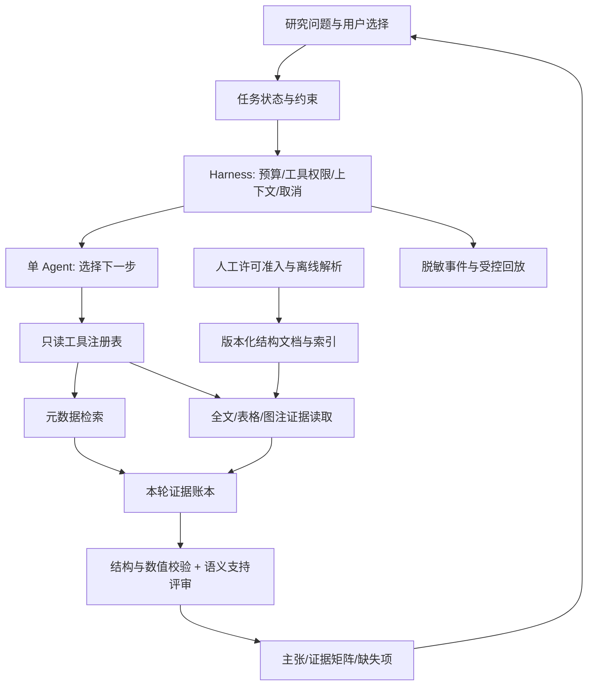

# PaperTrail：面向国内 Agent 岗位的项目评审

日期：2026-10-11。性质：静态评审与实施前方案建议。本文件保留当时的岗位视角和基线发现；用户随后恢复并授权了路线图的本地实施。当前代码、检查、质量限制和用户验收状态以 [refinement-roadmap](2026-10-11-refinement-roadmap.md)、[`docs/PROGRESS.md`](../PROGRESS.md) 和根目录 [`current_contexts.md`](../../current_contexts.md) 为准。

## 1. 结论和评审边界

**PaperTrail 值得继续做，推荐定位为“带原文证据的论文研究任务 Agent”。它已超过简单聊天页面，但当前对真实任务完成率、论文证据正确性和 PDF 结构质量的证明不足。** 下一阶段应优先形成可信的任务闭环、证据契约和评测，再扩展 MCP、运行时 Skills 与可选多 Agent。

从简历展示角度，参考的 car-selection-assistant 在业务闭环、会话约束、运行排障和实验记录上更完整，能够提供更多面试讨论材料；它也有评测判定偏宽、复杂业务逻辑集中、部分 CI 检查仅报告等问题。不能因测试数量或技术名词更多，就判定它全面优于 PaperTrail。两个项目处理的任务、语料和评价目标不同，指标不能横向排名。

本评审采用模拟招聘方视角，并非代表某家公司或实际招聘委员会。岗位资料是少量公开样本，不能推断整个国内市场的比例、统一门槛或录用概率。

### 检查范围

- PaperTrail：本地规格、进度、任务、Agent/model/tools、PDF 解析与分块、全文导入和向量索引、评测实现、相关测试和 CI；也读取了用户提供的前次解析讨论。
- 参考仓库：README、目录树、Agent engine/session/shadow report、RAG pipeline、Agent/RAG eval、回放导出脚本、Skills 注册表与 CI 等关键文件。读取时 main 对应提交 `621833da1a009d8571ddac7bb65aa78f8f4d33b4`，提交日期 2026-10-07；不是全仓逐行审计。
- 本轮未运行两项目的产品测试，未调用真实模型做评测，未验证参考项目线上部署，未检查它最新 Actions 运行。README 中的测试数、部署与实验结果是作者报告。
- 当前 `D:\papertrail-main` 缺少 `.git`；`git status` 失败，无法确认分支、与远端的差异或已有文件的修改归属。没有覆盖产品源码、暂存、提交或推送。

## 2. 国内岗位在要求什么

### 公开岗位样本

| 来源与读取方式 | 可观察的要求 | 对个人项目的启示 |
|---|---|---|
| [软通动力 AI 应用开发工程师，智联招聘职位正文](https://www.zhaopin.com/jobdetail/CC000544460J40793906616.htm) | Agent 工作流、MCP Server、RAG 调优、国内模型、Linux/Docker 与效果评估 | 做出一个可运行的业务闭环，能解释集成与调优选择 |
| [中创实大模型应用工程师，智联招聘职位正文](https://www.zhaopin.com/jobdetail/CCL1281633590J40828735901.htm) | 多 Agent 编排、状态与异常处理、工具集成、异步服务与独立排障 | 展示状态、失败原因和复现方法，不能只展示成功截图 |
| [上海人工智能实验室：Agent 审计与自进化算法工程师，官方正文](https://www.shlab.org.cn/joinus/detail/7673686983583385865?mode=7) | 轨迹采集、过程/结果评测、反馈改进；另有机器学习与研究要求 | Agent 评测本身有岗位价值；训练研究能力仍须另外证明 |

补充检索命中 [腾讯岗位](https://careers.tencent.com/jobdesc.html?postId=2061654749727600640)、[小鹏岗位](https://xiaopeng.jobs.feishu.cn/index/position/7617732237378930998/detail) 的 Agent、工具与评测相关片段，但动态详情页未返回可读正文，只作线索，不据此作详细判断。职位可能更新、关闭或随登录条件展示不同内容。

**我的推断：工程向岗位更容易被“业务任务 + 稳定执行 + 可追溯评测 + 服务工程”打动。** 岗位关键词可以引导补齐能力，但不是必须集齐的清单。

### 先选岗位方向

| 方向 | PaperTrail 可以提供的证据 | 仍需单独补齐 |
|---|---|---|
| Agent / LLM 应用工程 | 工具契约、任务状态、研究助手、故障处理、API/UI、成本质量对照 | 真实任务评测与运行闭环；基础后端能力 |
| RAG / 检索工程 | 结构化 PDF、证据检索、BM25/dense/hybrid、消融与失败分析 | 有效的人审测试集、排序与表格质量、索引规模实验 |
| Agent 平台 / 基础设施 | Harness、协议适配、预算、回放、隔离、checkpoint | 并发、持久化恢复、身份权限、部署与负载证据 |
| Agent 算法 / RL 研究 | 可提供任务环境、轨迹、grader 与失败分类 | 训练算法、数学/研究基础、实验复现；应用项目不能替代这些 |

建议优先投递前两类。初级/实习展示一个自己能解释的完整项目即可；中高级岗位通常还会追问规模、并发、运维和真实业务经验，不能用模拟实验代替工作经历。

### 我会如何面试这个项目

这是建议的评审维度，不是行业统一评分表：

1. **任务价值**：用户能完成什么？为什么需要 Agent 动态选工具？固定检索流水线是否更合适？
2. **实现理解**：亲自解释一次 function call 从模型输出到验证、执行、回传、终答的全过程；说明失败分支。
3. **数据和证据**：一句实验结论对应哪篇论文、哪个版本、哪一页、哪个表格单元格？
4. **实验可信度**：题目怎么来、标签谁审核、如何隔离调参集、是否把全拒答误判成高正确率？
5. **系统能力**：超时、重复调用、上下文膨胀、用户取消、重启、外部服务失效如何处理？
6. **取舍与贡献**：能解释一个失败实验、一次有证据的回退，以及自己对 AI 辅助代码的审查和修改。

## 3. 参考项目：可借鉴，也需要审查

参考项目：[car-selection-assistant](https://github.com/CN-Discretemathematics/car-selection-assistant)。以下源码链接固定到本轮检查的提交，避免 main 后续变化。

| 维度 | 参考项目观察 | PaperTrail 当前情况 | 推荐借鉴 |
|---|---|---|---|
| 产品闭环 | 购车需求、澄清、推荐、对比、约束与追问 | 检索、详情、元数据比较、单轮 Agent | 研究问题、论文范围、证据矩阵、追问与导出验收 |
| 会话状态 | 有会话存储、TTL/容量边界、Redis 实现 | ask 接口按单个 question 运行 | 存研究约束和选定论文，不把所有历史塞进 prompt |
| 业务校验 | 回答的数字/名称与工具结果集合比对 | 主要验证引用论文 ID 属于本轮观察 | 引入逐主张证据和单位/工况校验；集合成员检查仍不等于语义支持 |
| RAG 工程 | 分阶段图、条件检索/重排、消融记录 | BM25/dense/RRF，有探索评测 | 展示阶段指标、错误桶、同题对照与明确回退 |
| 运行排障 | 路由 shadow、会话日志、回放导出、负载工具 | 有脱敏运行 trace，未持久化 | 小范围可复现记录、脱敏回放、失败复盘 |
| 工程交付 | 部署配置、运维页面、测试/报告文件丰富 | 锁依赖、OpenAPI、迁移、Web E2E 已具备 | 复现说明、受控部署与用户演示；避免急于堆基础设施 |

对应源码：[session.py](https://github.com/CN-Discretemathematics/car-selection-assistant/blob/621833da1a009d8571ddac7bb65aa78f8f4d33b4/backend/app/agent/session.py)、[RAG pipeline](https://github.com/CN-Discretemathematics/car-selection-assistant/blob/621833da1a009d8571ddac7bb65aa78f8f4d33b4/backend/app/rag/pipeline.py)、[shadow_report.py](https://github.com/CN-Discretemathematics/car-selection-assistant/blob/621833da1a009d8571ddac7bb65aa78f8f4d33b4/backend/app/agent/shadow_report.py)、[回放导出脚本](https://github.com/CN-Discretemathematics/car-selection-assistant/blob/621833da1a009d8571ddac7bb65aa78f8f4d33b4/backend/tools/replay_conversation.py)。最后一个脚本主要导出会话，并不自身证明模型执行可确定性重放。

### 不应直接照搬的部分

1. **Agent 评测存在宽松判定。** [eval_agent.py](https://github.com/CN-Discretemathematics/car-selection-assistant/blob/621833da1a009d8571ddac7bb65aa78f8f4d33b4/backend/tools/eval_agent.py#L47) 把无候选推荐判为通过；该脚本使用无密钥确定性引擎，不能证明真实 LLM 工具选择质量。对比只要求至少一个结果，检索主通过条件只要求非空，未知意图保留初始成功状态。关键词拒答与“至少一个 citation”也不等同于正确完成任务。这些发现限于该脚本，不能据此否定其其他测试和 RAG 评测。
2. **维护复杂度明显。** [engine.py](https://github.com/CN-Discretemathematics/car-selection-assistant/blob/621833da1a009d8571ddac7bb65aa78f8f4d33b4/backend/app/agent/engine.py) 约 2,700 行，集中路由、状态、业务规则、工具循环与兜底。PaperTrail 应保留模块边界，防止需求新增后变成一个大 engine。
3. **CI 有强弱门禁差异。** [CI](https://github.com/CN-Discretemathematics/car-selection-assistant/blob/621833da1a009d8571ddac7bb65aa78f8f4d33b4/.github/workflows/ci.yml) 中 Ruff job 为 report-only；存在 lint 报告并不代表 lint 通过。PaperTrail 当前 CI 的 Ruff 检查是阻断式，应保留。
4. **开发 Skills 不等于产品运行时 Skills。** [Skills 注册表](https://github.com/CN-Discretemathematics/car-selection-assistant/blob/621833da1a009d8571ddac7bb65aa78f8f4d33b4/skills/SKILLS.md) 明确有开发工作流沉淀。目录存在，不能证明用户 Agent 已实现动态发现、加载和调用。
5. **图工作流不自动等于多 Agent。** 已检查的 RAG 图是召回、融合、重排等阶段；工具循环是单个 Agent 运行。没有在本轮检查范围找到足以确认产品级 MCP 集成或真正多 Agent 协作的实现证据，不作全仓“绝对不存在”的断言。
6. **高指标需要解释生成方式。** 从结构化车辆库自动构造的题与标签，可以验证闭集数据一致性；不能自动推广到开放研究问题。模型评审之间一致也可能共享偏差，应有人工校准。

所以它作为个人简历项目是较完整的工程案例，值得学习；是否优秀最终取决于复现、任务表现与作者解释能力。不要复制领域规则、测试数量或报告口径。

## 4. PaperTrail：已有优势和最需要修正的问题

### 已有能力应保留

- 真实 OpenAlex/arXiv 元数据来源、快照、不可变版本与 ID 对齐。
- 全文人工许可确认、当前版本过滤、撤回删除与哈希审计。
- `PaperToolRegistry` 固定只读工具、输入 schema、模型调用与 Harness 分离；已经有真实 function calling 实现，不能称作“只有 RAG”。
- `AgentHarness` 有轮数/工具次数/总时间预算、失败状态、运行 ID、token 与脱敏 span。限制是这些预算还不等同于完整可恢复执行系统。
- BM25/dense/hybrid 同接口、锁依赖、SQL 迁移、OpenAPI 和浏览器交互测试。
- AI 标签与 mock 结果被明确标为探索或非质量证据，这种诚实口径本身有工程价值。

### 具体发现

| 优先级 | 发现与依据 | 影响 | 建议验收方向 |
|---|---|---|---|
| 高 | [harness.py:203](../../backend/app/agent/harness.py:203) 主要验证 cited 论文 ID 来自观察；[contracts.py:94](../../backend/app/agent/contracts.py:94) 无逐主张证据绑定 | 可以引用真实论文，却写出该论文不支持的结论；元数据证据与全文结论未强制分开 | 逐 claim 绑定本轮 span，数值/单位检查，人工语义支持评分 |
| 高 | [pdf_parser.py:39](../../backend/app/retrieval/pdf_parser.py:39) 每页重置章节；段落 bbox 取整页；正则猜标题 | 跨页章节错误、正文误识别、无法准确高亮段落 | 保存元素级结构与真实区域，声明坐标系；用人工标注版面对照 |
| 高 | [pdf_parser.py:94](../../backend/app/retrieval/pdf_parser.py:94) 表格检测异常置空；表格转竖线文本，正文另含整页文本 | 解析失败难发现、证据重复；复杂表头/单位/脚注丢失 | 部分成功状态与错误清单；单元格结构；正文去重 |
| 高 | [pdf_parser.py:124](../../backend/app/retrieval/pdf_parser.py:124) 图注按同一 y 行归组，按纵向最近配图，无水平/距离门槛 | 双栏图注串列、多行截断、错配；嵌入图片不能覆盖所有矢量图 | 图注全文、图/图注独立区域、编号和关系；不支持时明确拒答 |
| 高 | [fulltext.py:94](../../backend/app/retrieval/fulltext.py:94) 每元素 char offset 从零开始，未保存明确 element ID；按字符截断表格 | 若消费者当全文 offset 使用会错位；同页多块定位含混、表格可能断行丢表头 | 明确局部/全局 offset；持久化 element ID；行组切块保留表头 |
| 中 | [index_fulltext_embeddings.py:41](../../backend/app/cli/index_fulltext_embeddings.py:41) 仅嵌入 chunk text | 已存章节和来源上下文未进入向量表示；短碎片语义不足 | 分开 retrieval_text 与 evidence_text，对上下文增强做消融 |
| 高 | [service.py:35](../../backend/app/agent/service.py:35) 每次 ask 新建 Harness，以 question 为入口 | 难展示澄清、论文选择、追问修正、任务恢复 | research task/session 状态与明确状态转移 |
| 中 | Harness 检查时间预算，但模型/工具为同步执行；token 是统计，未见总上下文/总成本硬预算 | 单次阻塞仍需底层超时；未来多轮上下文可能膨胀 | 每调用剩余时间、可取消执行、上下文选择、token/成本预算 |
| 高 | [P12 runner](../../backend/app/evaluation/p12.py:198) 是固定 mock 场景；[P14 验收](../research/P14-acceptance.md:5) 为 AI-qrels 元数据探索 | 不能证明真实论文 QA、PDF 检索或真实 Agent 成功率 | 新建许可全文、人审证据与真实模型任务测试集 |
| 高 | TASKS 有重复 P17，既 done 又 in progress；规格说已完成，但 PDF 用户验收、E2E 收尾仍有缺口 | 评审者难确认哪些通过；会降低结果可信度 | 统一实现/自动测试/真实质量/用户验收四种状态 |

以上 PDF 行为来自源码静态检查，不声称每份 PDF 必然失败，也没有用真实语料量化错误率。标题正则、表格恢复、图注关联必须通过样本实验验证。

**需要纠正此前进度口径：P17 是初版实现与部分自动检查完成，尚不能称为 PDF 质量及用户验收完成。** 本轮会统一任务台账；历史测试记录保留。此前 Next.js 安全公告和 E2E 未退出是历史记录，需开发恢复后重新检查，不能当成本轮审计结论。许可导入也建议前移全部准入校验：CLI 先检查确认开关和 manifest，但受支持许可证等完整规则应在 PDF 解析前统一验证，防止不合规输入已被处理后才在入库时拒绝。

## 5. 建议的整体设计

### 核心用户任务

选一条贯穿演示和评测的路径：

> 用户提出研究问题 → 澄清范围 → 检索/选择论文 → 从批准全文读取方法、实验与局限证据 → 生成跨论文对照矩阵 → 回答并逐项链接原文 → 标出缺失/不可比项 → 用户检查。

例如：“比较三篇论文的检索方法与实验结果，哪些结果能够直接比较？”系统必须记录任务、数据集、指标方向、单位、baseline、实验设置；设置不一致时分别呈现，不能直接给跨论文排名。图中没有可读精确值时只能描述有证据的趋势或拒绝数值回答。

### 建议分层

保留只读 Agent 边界：导入、删除、迁移和索引是独立管理流程；保存任务状态由服务代码按固定 schema 完成，不向模型开放自由写库、任意 URL、SQL 或 shell。图中的语义支持评审不是万能证明器，仍须人工校准和输出限制。

### 数据契约与 PDF/RAG

1. 文档层保留 `document_version_id/source_document_sha256/license/parser_version`；结构层保存章节树、元素 ID、原文、页码、bbox/坐标系、父子关系、表格 cells 和 caption links。
2. 索引层保存 `retrieval_text` 与向量；证据层保存未经生成改写的 `evidence_text` 和位置。标题、章节、模型生成描述可以帮助搜索，但不能冒充论文原文。
3. 正文按章节/段落/句子和 token 限额切分，小块召回、父块有界扩展；跨页保留结构。表格按行组切分、重复表头/单位/脚注、保留完整原表与单元格地址。
4. 图片裁剪仅保存在本机受许可存储，与 PDF 同样处理撤回/删除；原图、作者图注、模型生成解释分开标记。视觉回答是可选后续功能，精确数字优先原表/原数据。
5. 更换解析器先做适配器与小样本同题实验。前次讨论中的 Docling/MinerU/GROBID 是待选候选，不在本轮断言谁质量最高；实施前核对当时版本、许可证、依赖/硬件及官方能力。保留 pdfplumber 作为轻量 baseline。
6. 先改解析/证据，再比较分块，再比较 BM25/dense/hybrid/reranker；一次只改一个主变量。新分块版本触发索引失效/重建，标注按原始元素或单元格保存，避免标签绑定旧 chunk ID。

### Harness engineering 应该落到什么代码

建议把“模型外面的执行系统”做成可测能力：

- 一套 versioned ToolSpec：用途、输入/输出 schema、固定权限、错误码、体积、时间、版本；本地 API 与 MCP 共享业务实现。
- `ResearchTask`：用户约束、选定论文/版本、状态、预算余量、待澄清项、证据索引；用户改变范围时显式失效旧约束与证据。本轮回答使用本轮实际观察；以前选定的资料需重新校验当前许可与版本。
- 上下文选择器：预算内保留问题、约束、相关 evidence IDs 与必要片段；摘要可辅助，但不能替换原始证据。跟踪输入、输出、工具 observation 和压缩开销。
- 错误分类和有限重试；工具返回 `partial/no_results/unavailable` 不伪装成功。截止时间向每次调用传递；取消/重启后的状态可解释。
- 事件记录与两种回放：录制输出的离线契约回放、重新调用模型的效果复测。后者允许非确定性，需多次运行；不要承诺逐字重现。
- 默认只存脱敏元数据；带问题/片段的排障材料单独开关、有效期、删除接口，本机忽略目录，不进 Git；不要求保存模型私有思维链。
- 模型接口保持独立。国内模型适配可作为岗位展示项，但必须做能力探测和工具 schema 契约测试；不能假设所有兼容接口都等价。

关于 checkpoint，可参考 [LangGraph persistence](https://docs.langchain.com/oss/python/langgraph/persistence)：thread 状态和跨线程存储用途不同。是否引入框架应通过 ADR 比较现有 Harness 的增量改造、恢复需求和依赖成本；内存 checkpoint 不能证明重启恢复。

## 6. Agent、multi-agent、Skills、MCP 怎样合理加入

### 单 Agent 与工作流

默认保持单 Agent；它负责在允许的工具和预算内决定检索、取证、澄清还是终止。解析、许可校验、表格计算和引用完整性由确定性代码承担。固定步骤工作流与动态 Agent 都有价值，[Anthropic 的实践说明](https://www.anthropic.com/engineering/building-effective-agents) 也区分二者，并建议从简单方案开始。

### 运行时 Skills

产品 Skills 可从 `paper-qa`、`compare-papers`、`research-brief` 三个入手：定义触发条件、步骤、证据标准、输出契约、失败示例与评测题。按 [Agent Skills 标准](https://agentskills.io/home) 使用 `SKILL.md` 元数据和按需加载，记录加载版本和选择结果。

验收要覆盖选对/不误选、只加载相关内容、输出契约、恶意说明不能提升工具权限，以及开/关 Skill 的同题效果。产品 Skill 不能自带未经验证的论文事实；本项目初版不执行 Skill 内任意脚本。开发者检查/文档同步 Skills 单独维护。新增权限元数据可用项目内部 sidecar，不把自定义字段宣称为标准必需项。

### MCP

目标是让一个实际客户端通过协议复用 `search_papers/get_paper/retrieve_paper_evidence` 等只读能力，并保持与直接调用一致的许可/版本/来源约束。它是集成协议，不是模型推理能力或多 Agent 框架。[MCP 官方架构](https://modelcontextprotocol.io/docs/2026-07-28/learn/architecture) 区分 tools/resources/prompts 与客户端、服务器职责。

先做本地 stdio adapter 与真实客户端契约测试；固定服务器与工具白名单，权限不因发现新工具而扩大。资源访问也要许可校验、有界响应和错误处理。协议与 SDK 版本需锁定并验证客户端兼容性；本轮官方文档为 2026-07-28 版本，不假设旧 SDK 的握手方法与新版本相同。远程 HTTP、OAuth、多租户放到实际需求出现后。

### 可选 multi-agent

适用候选：多个论文证据抽取 worker，各自限定文档范围；supervisor 汇总一致 schema，再执行独立校验。worker 必须有独立任务/运行轨迹/模型决策，简单并发函数或多 prompt 阶段不能宣传成完整协作系统。

共享总 token/时间/成本预算，限制并发和递归；worker 不能把结论当另一个 worker 的原文证据。处理部分失败、重复证据、冲突和取消。judge/critic 也可能错，多 Agent 投票不替代证据核验。

只有完成单 Agent baseline 后，再对比：固定工作流、单 Agent、多 Agent；使用相同问题、文档、模型能力和费用上限，记录任务成功、证据支持、p95 延迟和成本。如果没有明确收益，保留单 Agent 默认，记录实验结论。这比为了简历而强行采用 multi-agent 更容易解释。

## 7. 怎样验收才有说服力

评测须区分 task、trial、grader、执行轨迹与结果；代码断言、模型判分和人工检查用途不同，可参考 [Agent evals 实践](https://www.anthropic.com/engineering/demystifying-evals-for-ai-agents)。以下是针对 PaperTrail 的建议，不是该文章给出的标准门槛。

### 三套证据，各自报告

| 层 | 用什么数据 | 验证什么 | 不能声称什么 |
|---|---|---|---|
| 工程回归 | TEST-*、synthetic=true；fake HTTP/model | schema、迁移、越权拒绝、错误分支、UI、退出码 | 真实模型效果、账单、复杂论文质量 |
| 真实语料质量 | 逐篇确认许可，人工标注原文位置，冻结版本 | PDF 阅读顺序、单元格、证据召回、主张支持 | 超出样本/场景的泛化准确率 |
| 运行与用户验收 | 固定模型/参数，受控真实运行与手工检查 | 多轮任务、失败恢复、成本、时间、可用性 | 几次 smoke 就是完整 benchmark |

起步建议 10—12 篇含单栏/双栏/跨页表格/图片或矢量图的许可论文，40 道题，其中约 10 道缺失证据/范围外题。预算允许后扩为 20—30 篇、100 道题（建议开发 60 / 保留测试 40，按论文或主题分组以降低泄漏）。这只是规划，不存在已准备好的数据集。扫描件/OCR 是单独能力桶，未支持时验收正确识别和拒绝处理。

标签至少包括问题、可答性、允许答案要点、相关原始元素/单元格、单位/实验条件、错误类型、审核者与版本。AI 可以拟题或预标注，但只有实际人审过的记录才能标 human-reviewed；只有一位审核者就如实记录，不能伪称双人审核。论文内容、题目含原文部分与模型报告按当前仓库规则留在本机。

### 指标与防作弊

- PDF：阅读顺序抽查、元素类型、章节归属、bbox 可定位率、表格 cell/表头/单位恢复、图注匹配；每类报告样本数，不能只统计“产生多少块”。
- 检索：原始 evidence-level recall@k、MRR/nDCG、双论文证据覆盖、表格题分桶、延迟；同时记录 parser/chunker/embedder/index hash。
- 回答：任务完成率、逐主张证据支持率、应有事实覆盖、数值/单位正确率、正确页/表引用率。来源 ID 合法率另列，不代替支持率。
- 拒答：可答题误拒率、不可答题正确拒答率；全拒答不会获得高任务分。空检索、澄清、partial、completed 分开计数。
- Agent：工具参数合法率、工具失败后的合理处理、冗余调用、预算超限、注入越权；检查安全和证据不变量，不强制每个正确回答采用唯一工具顺序。
- 工程：p50/p95、tokens、请求数、估算费用与可获取的实际计费；把外部服务延迟单列。小样本尾延迟与比例波动需说明，多次 trial 不作为独立新题夸大样本数。

建议真实模型先每题 3 次，固定模型版本/参数/提示/Skill/工具/语料快照；同时保留失败例。LLM judge 用人审子集校准，报告一致与分歧，避免评测模型把生成文风当正确性。按问题/文档聚合重复运行；必要时按该单位 bootstrap 区间，不用一位小数掩盖小样本不确定性。

质量 gate 的建议值见路线图。先用开发集验证其可行性，再冻结阈值并测保留测试集；不能看完测试成绩后修改题集或门槛以宣布通过。

## 8. 简历与演示怎么呈现

推荐标题：**PaperTrail：可追溯证据的论文研究 Agent**。第一句写用户任务；后面写自己完成的工具契约、结构化证据、Harness 与实验结果。MCP/Skills/multi-agent 仅在可运行并验收后加入。

验收前可写：“实现受限工具调用、许可全文检索、BM25/dense/RRF 对照与页级定位初版；建立合成回归和探索评测，真实 PDF/Agent 质量验收进行中。”不要把 103 个单测写成“回答准确率高”，不要把 P14 AI 标签写成人工金标。

验收后再填真实结果模板：“在 N 篇许可论文、M 道独立人审题上，方案 B 相对 baseline 的任务成功率为 X/Y，证据支持率为 A/B，平均费用/延迟为 C/D；同时说明失败桶和样本限制。”此模板没有预填任何成绩。

准备一段 3—5 分钟演示：一题成功取证、一题实验不可比、一题证据不足、一段失败回放。面试附件建议包括架构 ADR、评测定义、脱敏结果摘要、一个 bug 修复复盘与复现步骤。按照项目约定，不提交真实全文、个人数据、数据库或模型生成报告。

最值得讲清的五个问题：为什么这些工具分开；为什么表格不能按字数硬切；如何证明引用支持主张；为什么某个重排/多 Agent 实验不值得启用；一次失败如何定位到 parser/retrieval/model/harness。

## 9. 推荐决策

优先顺序：**状态与验收口径 → 冻结许可语料/任务 → 结构证据与引用契约 → 真实质量 baseline → 会话/Harness → MCP/Skills → 有收益才上线 multi-agent。**

先把 PaperTrail 的论文证据优势做深，再扩展技术展示宽度。当前不建议全面重写、替换所有存储、增加任意网络浏览或引入自由写库工具。完整实施任务、依赖和用户验收过程在配套路线图中；恢复开发须由用户明确指示，发布仍须用户验收后另行授权。
